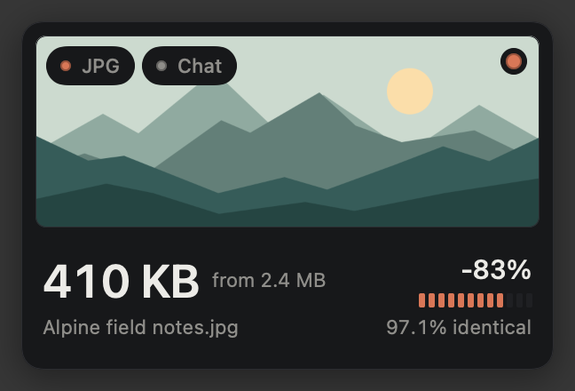
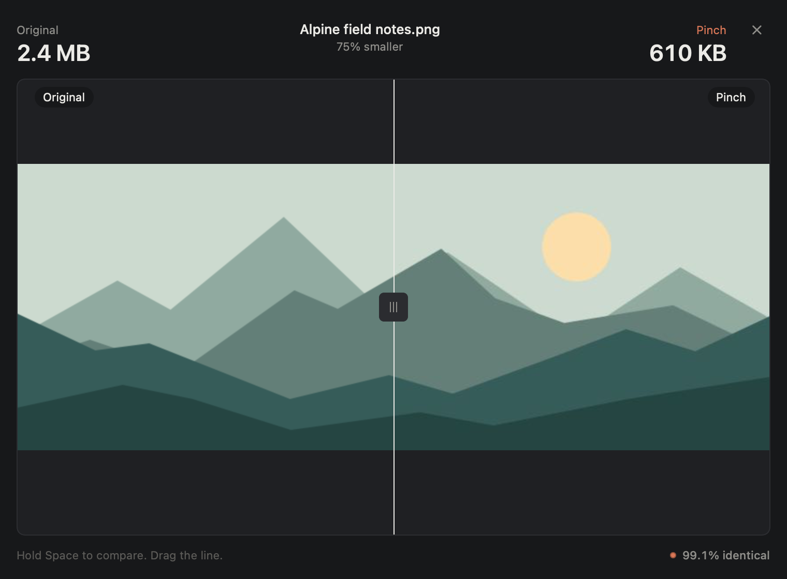

# Pinch

Copy large, paste small. Pinch shrinks every screenshot, photo, GIF, screen recording and PDF on your Mac to the smallest file you can't tell from the original, and tells you how much it saved.

<p align="center"> </p>

<p align="center">   </p>

## How it works
Most optimisers apply a fixed quality and hope. Pinch measures. For every image it encodes several candidates (palette PNG, mozjpeg, WebP, AVIF and others), searches each encoder's quality knob, and compares every try with the original using SSIM, the structural similarity score. It keeps the smallest file that still reaches the target of your preset. Video quality is searched the same way on sampled frames. If the result is not at least 3% smaller, your original stays untouched.

On the benchmark set in [docs/bench.md](docs/bench.md) the results are 10% smaller in total than a fixed-quality pipeline (screenshots 24 to 43% smaller, photos 34 to 48%), and every result stays at 98.5% identical or better.

## Presets
| Preset | What it does |
|---|---|
| Visually identical | Default. Keeps the format, targets SSIM 0.985. |
| For chat | Long side 1600 px, WebP when you drop files, SSIM 0.97. |
| For AI | Long side 1568 px, PNG or JPEG only, SSIM 0.97. |
| For the web | AVIF (or WebP if you prefer), SSIM 0.98. |
| Lossless | Same pixels: oxipng and jpegtran only. |

Pick the default in Settings, change it for one result from the card's More menu, or choose one per drop.

## What else it does
- **Floating result card.** A screenshot or copied image lands, the size counts down, the card shows `99.1% identical`. Drag the result out, copy it, restore the original.
- **Compare.** Hold Space over a card or a menu row for a before and after with a draggable split line.
- **Drop zone.** Drag files or folders onto the menu bar icon, or onto the strip that appears at the screen edge while you drag. Folders are processed recursively with a progress card.
- **Experimental private info blur.** Off by default in Settings → Privacy. When enabled, Pinch blurs matching emails, API keys, phone and card numbers on this Mac. It can miss details; check the image before sharing.
- **Copy text.** ⌃⌥T reads the text in an image (Vision, on device) and copies it.
- **Auto-name.** Screenshots are renamed to the app, date and time.
- **Metadata.** GPS and camera data are stripped by default; colour profile and orientation stay.
- **Video.** HEVC or H.264 through VideoToolbox, silent audio tracks removed, frame rate capped on request.
- **PDF.** Images downsampled to the preset's resolution, text and vectors untouched.
- **Shortcuts.** App Intents: Optimise files, Convert image, Copy text from image.
- **History.** The menu bar panel shows today's savings and your recent results.

## Command line
Settings, General has a button that installs `pinch` into `~/.local/bin`.

```
pinch optimise photo.png screenshots/ --preset chat --to webp --out small/
pinch optimise *.mov --preset identical
pinch presets
```

`--to` converts images (png, jpg, webp, avif, jxl, heic) and GIFs to mp4; originals are kept. Without `--out`, files are replaced in place and the original is kept in `~/Library/Caches/Pinch/backups`.

## Install
**Homebrew**

```
brew install --cask noterikkirillov8/tap/pinch
brew install pngquant oxipng mozjpeg webp libavif jpeg-xl gifsicle ffmpeg ghostscript
```

For an additional JPEG encoder, optionally run `brew install jpegoptim`. Relaunch Pinch after installing tools to refresh their status.

**Download**: get the zip from [Releases](https://github.com/noterikkirillov8/pinch/releases), unzip it and drag `Pinch.app` to Applications.

**Build from source**: see below.

Pinch uses the open-source encoders above from `/opt/homebrew`. It isn't notarised by Apple (that needs a paid developer account), so the first time macOS may say it can't verify the developer: open System Settings → Privacy & Security, scroll down and click Open Anyway (on macOS 15 and later right-click → Open no longer works).

## Privacy
Everything runs on your Mac. No network, no accounts, no telemetry, no update checks. Originals are kept in `~/Library/Caches/Pinch/backups`, and nothing is ever deleted.

## Build from source
Needs Xcode 16+, [XcodeGen](https://github.com/yonaskolb/XcodeGen) and the encoders above.

```
scripts/test-engine.sh        # engine tests
scripts/bench.sh              # benchmark against the previous engine
NO_OPEN=1 scripts/install.sh  # build Release and install to /Applications
```
`scripts/install.sh` signs with the author's local certificate if you have it, and ad hoc otherwise.

## Credits
Inspired by Clop by lowtechguys. MIT licence. Interface sounds by Kenney (kenney.nl), CC0.
